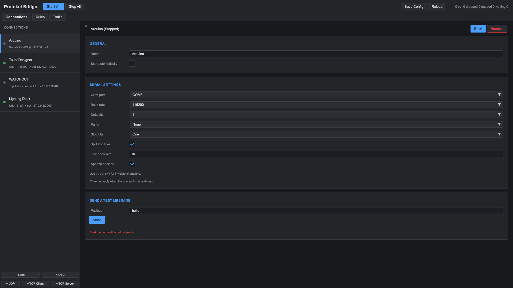
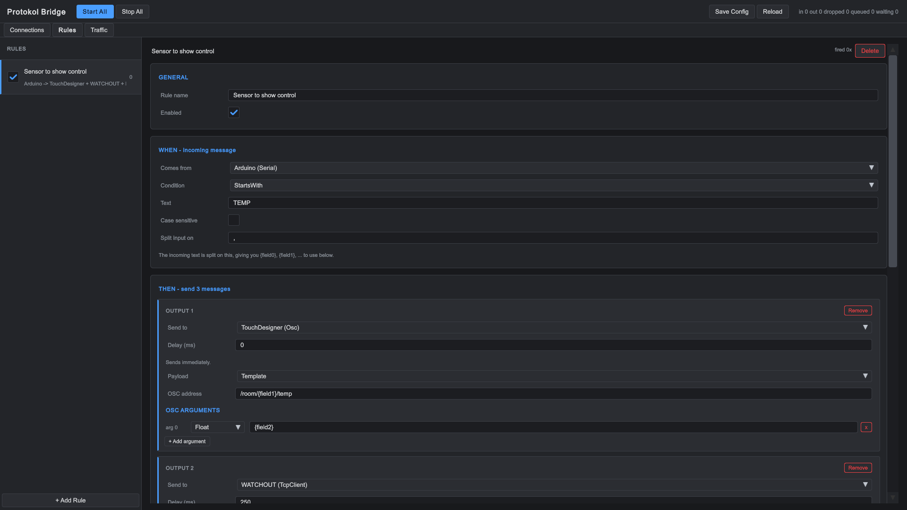
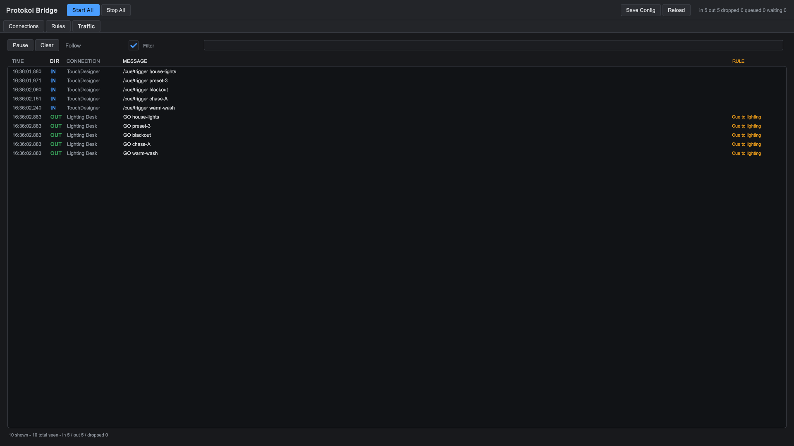

# Protokol Bridge

A desktop bridge for show-control protocols. It speaks **Serial, OSC, UDP and TCP**
at the same time and routes between them using rules you edit at runtime — so a line
arriving on a COM port can trigger a *different*, templated OSC message going out,
with its own delay.

Built with Unity 6 (6000.6.0f1). The operator configures everything from the app's
own UI; nothing needs the Unity Editor.



## What it does

- **Serial** — COM port, configurable baud/parity/data bits/stop bits, line framing
- **OSC** — send and receive, dependency-free OSC 1.0 codec including `#bundle`
- **UDP** — raw datagrams, unicast and broadcast
- **TCP** — client (with automatic reconnect) and multi-client server

Every connection is bidirectional.

## Routing

A rule is *when this arrives, send these*. The condition is matched once, then every
output fires — so one serial line can go out as OSC **and** UDP **and** TCP from a
single rule, each with its own payload and its own delay.

Outgoing messages are templates, not copies. Tokens available:

| Token | Meaning |
| --- | --- |
| `{text}` | the whole incoming message |
| `{field0}`, `{field1}` … | incoming text split on a separator |
| `{arg0}`, `{arg1}` … | OSC arguments of the incoming message |
| `{address}` | incoming OSC address |
| `{g1}`, `{g2}` … | regex capture groups |
| `{remote}` | sender (IP:port, or COM port) |
| `{time}` | arrival time |
| `{hex}` | raw bytes as hex |

For example, the serial line `TEMP,kitchen,21.7` with the address template
`/room/{field1}/temp` and a Float argument `{field2}` sends:

```
/room/kitchen/temp 21.7
```

The rule editor previews what each output will send before any hardware is connected.

## Interface

Three tabs.

**Connections** — add and configure endpoints, start and stop them, and send test
messages without needing the far end set up yet. Each connection shows its live state
and the real error from the OS if it fails to open.

**Rules** — the when/then editor. One condition, any number of outputs, each with its
own target, payload and delay. The screenshot below shows a single serial line fanning
out to OSC, a WATCHOUT cue over TCP, and a UDP lighting desk:



**Traffic** — live log of everything crossing the bridge, with filtering, pause, and
which rule produced each outgoing message:



## Building from source

Open the project in Unity **6000.6.0f1** and build `Assets/Scenes/Bridge.unity`.

> **Note:** API Compatibility Level must stay on **.NET Framework**.
> `System.IO.Ports.SerialPort` does not exist in the .NET Standard 2.1 profile, so
> serial support stops compiling if it is switched back.

Settings are saved to `protokol-bridge.json` in the app's persistent data folder.

## Status

Working and tested. Serial, OSC, UDP and TCP transports, the routing engine with
per-output delays, and the runtime UI are all functional.
